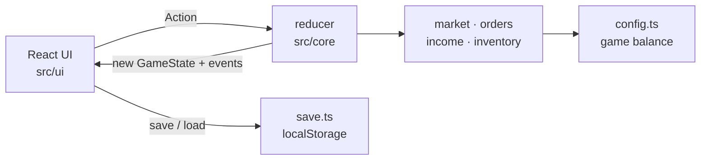

# Yuyu Mall 鈺鈺商城 — an online shopping simulator

**English** | [繁體中文](README.zh-TW.md)

A browser game about the joy of online shopping: browse a store whose prices change every day, grab flash sales, check out, track your parcels, unbox them, and fill your room with everything you bought. Earn money by going to work or by reselling what you own.

**▶ Play:** https://howhowc.github.io/shop-sim/

<!-- Screenshot: add docs/screenshot.png and uncomment

-->

## Features

- **Living market**: every in-game day, prices move within ±10%, one product goes on a flash sale, and you may receive a coupon.
- **Realistic order flow**: cart → coupon → checkout → *placed → shipped → in transit → delivered* (2–4 days).
- **Unboxing**: delivered parcels are opened with an animation, and the items go into your room.
- **My room**: shelves that fill up as your collection grows.
- **Earning money**: daily salary with promotions; a second-hand market where limited editions gain value the longer you hold them.
- **Auto-save**: progress is saved in the browser after every action, with versioned save files.
- Light and dark themes, phone-friendly layout.

## Tech stack

TypeScript · React · Vite · Vitest · oxlint · GitHub Pages

## Architecture

The game logic and the UI are completely separated, so new game modes (e.g. a seller mode) or a different front end can reuse the same core.



Key design decisions:

| Decision | Why |
|---|---|
| `src/core` is pure TypeScript with no React or browser APIs | Logic is unit-tested in isolation and can be reused by any front end |
| Every state change is an `Action` handled by an immutable `reducer` | One predictable place for game rules; easy to add new actions |
| Seeded RNG (Mulberry32) instead of `Math.random()` | Same seed + same actions = same result, so randomness is testable and saves resume exactly |
| Core returns event and error **codes**; the UI turns them into text | Rules stay language-independent; adding translations doesn't touch the logic |
| All balance numbers live in `config.ts` | Difficulty can be tuned in one file |
| Save files carry a version number plus migration functions | Changing the state shape later doesn't wipe players' progress |
| Order status is derived from dates, not stored | No state to keep in sync, so it can't drift |

## Getting started

Requires Node.js 22.12 or newer.

```bash
npm install
npm run dev        # http://localhost:5173
```

| Command | Description |
|---|---|
| `npm run dev` | Start the dev server |
| `npm test` | Run all unit tests once |
| `npm run test:watch` | Re-run tests on file changes |
| `npm run build` | Type-check and build for production |
| `npm run lint` | Lint with oxlint |

## Project structure

```
src/
  core/        game logic (pure TypeScript) + unit tests
    config.ts  all game balance numbers
  data/        product catalog (fictional brands)
  ui/          React components and styles
  save.ts      versioned save / load (localStorage)
```

## Roadmap

- [ ] Mini-game part-time jobs as another income source
- [ ] Shopping festival events (site-wide sales)
- [ ] Collection achievements
- [ ] Seller mode
- [ ] Leaderboard (Python / FastAPI backend)

---

All stores, brands, and products in this game are fictional.
