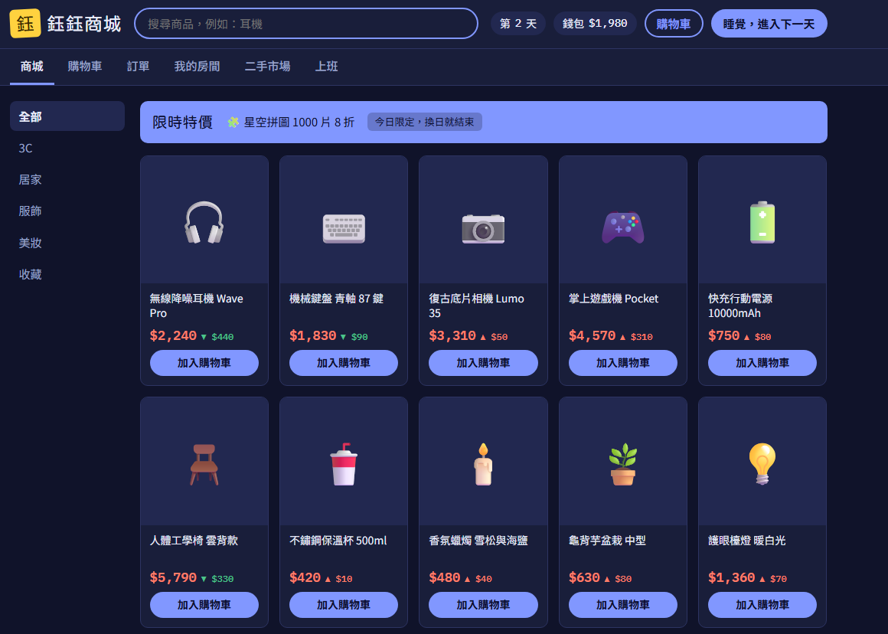
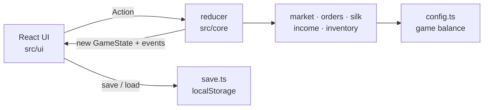

# Yuyu Mall 鈺鈺商城 — an online shopping simulator

**English** | [繁體中文](README.zh-TW.md)

A browser game about the joy of online shopping: browse a store whose prices change every day, grab flash sales, check out, track your parcels, unbox them, and fill your room with everything you bought. Earn pocket money with a daily check-in, by reselling what you own, by raising silkworms in a cozy mini-game, or by collecting gifts from your mailbox.

**▶ Play:** https://howhowc.github.io/shop-sim/



## Features

- **Living market**: every in-game day, prices move within ±10%, one product goes on a flash sale, and you may receive a coupon.
- **Realistic order flow**: cart → coupon → checkout → *placed → shipped → in transit → delivered* (2–4 days).
- **Unboxing**: delivered parcels are opened with an animation, and the items go into your room.
- **My room**: shelves that fill up as your collection grows.
- **Earning money**: a daily check-in tied to the real-world date, with bigger rewards for longer streaks; a second-hand market where limited editions gain value the longer you hold them; a silkworm-raising mini-game (see below).
- **Mailbox**: gifts arrive now and then — developer announcements unlocked by real-world date, random letters as days pass, and milestone rewards (first order, first moth, collection-book progress…). Attachments can be money, coupons, silkworm supplies or items. Everything is generated locally, with no backend.
- **Lucky roulette**: $100 a spin, three spins per real-world day. Every prize is worth at least $100, and the odds are shown on the page.
- **Auto-save**: progress is saved in the browser after every action, with versioned save files.
- Light and dark themes, phone-friendly layout.

## Mini-game: Silkworm Raising

A cute, low-pressure pet-raising game in its own tab. It shares your wallet with the store, so the cocoons you sell become shopping money.

- **Life cycle**: egg → 1st–5th instar → cocoon → moth, about 8 real-world days per silkworm.
- **Daily care**: feed one mulberry leaf a day and the silkworm grows one stage the next day. Forget a day and it simply waits; nothing ever dies. Impatient? A speed-up ticket grows a silkworm one stage instantly.
- **Affection**: feeding and petting raise affection, which decides the cocoon's quality (normal / good / great) and its price.
- **20 fictional breeds** across four rarities: flavour colours like 抹茶蠶 and 芋頭蠶, silkworms wearing bunny, bear, strawberry or chick hats, and legendaries such as the rainbow-segmented 彩虹蠶 and the softly glowing 月光蠶. The breed is drawn when you buy the egg and revealed when it hatches; odds are set per rarity (premium eggs favour rarer breeds), so new breeds need no odds tuning.
- **Shop and box**: the silkworm shop has its own cart that accepts the same coupons as the store, and items arrive instantly; eggs and leaves bought in the main store go to the same place. Eggs wait in storage until you place them in the box to hatch. Habitat expansions add room, and the box can be sorted by age, time acquired, rarity or affection.
- **Sell or collect**: sell larvae or cocoons for money, or let a cocoon become a moth to complete its collection-book entry (moths can only be released, not sold).
- **Collection book**: each breed records whether you have hatched it and raised it into a moth; undiscovered breeds show as silhouettes.
- All silkworm art is generated SVG; a breed is just a set of colours, a pattern, an optional hat and an optional glow.

## Tech stack

TypeScript · React · Vite · Vitest · oxlint · GitHub Pages

## Architecture

The game logic and the UI are completely separated, so new game modes (e.g. a seller mode) or a different front end can reuse the same core.



Key design decisions:

| Decision | Why |
|---|---|
| `src/core` is pure TypeScript with no React or browser APIs | Logic is unit-tested in isolation and can be reused by any front end |
| Every state change is an `Action` handled by an immutable `reducer` | One predictable place for game rules; easy to add new actions |
| Seeded RNG (Mulberry32) instead of `Math.random()` | Same seed + same actions = same result, so randomness is testable and saves resume exactly |
| Core returns event and error **codes**; the UI turns them into text | Rules stay language-independent; adding translations doesn't touch the logic |
| All balance numbers live in `config.ts` | Difficulty can be tuned in one file |
| Save files carry a version number plus migration functions | Changing the state shape later doesn't wipe players' progress |
| Order status is derived from dates, not stored | No state to keep in sync, so it can't drift |
| Real-world dates (check-in, silkworm growth) are passed in by the UI | The core stays pure and deterministic, so day-by-day growth is unit-tested without faking the clock |

## Getting started

Requires Node.js 22.12 or newer.

```bash
npm install
npm run dev        # http://localhost:5173
```

| Command | Description |
|---|---|
| `npm run dev` | Start the dev server |
| `npm test` | Run all unit tests once |
| `npm run test:watch` | Re-run tests on file changes |
| `npm run build` | Type-check and build for production |
| `npm run lint` | Lint with oxlint |

## Project structure

```
src/
  core/        game logic (pure TypeScript) + unit tests
    config.ts  all game balance numbers
  data/        product catalog, silkworm breeds and mail templates (all fictional)
  ui/          React components and styles
  save.ts      versioned save / load (localStorage)
```

## Roadmap

- [x] Mini-game: silkworm raising
- [ ] Silkworm v2: achievements, habitat decorations, moths laying eggs
- [ ] More mini-games
- [ ] Shopping festival events (site-wide sales)
- [ ] Collection achievements
- [ ] Seller mode
- [ ] Leaderboard (Python / FastAPI backend)

---

All stores, brands, and products in this game are fictional.
