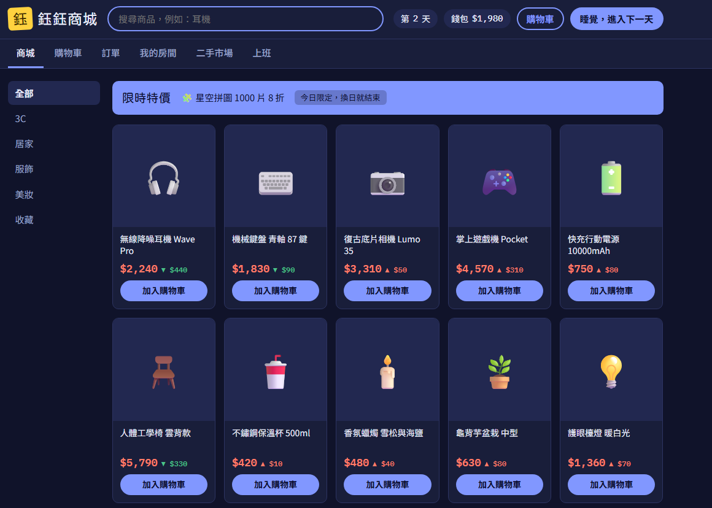
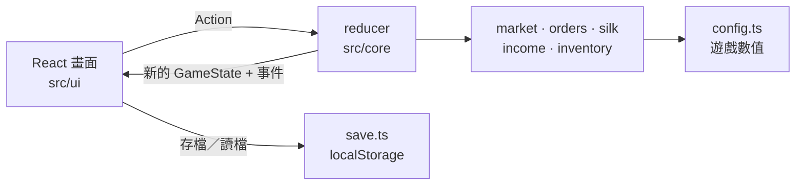

# 鈺鈺商城 — 網購模擬器

[English](README.md) | **繁體中文**

一款滿足網購慾望的網頁遊戲：逛一間每天價格都在變動的商城、搶限時特價、結帳、追蹤物流、開箱，再把買到的東西擺滿你的房間。錢不夠時可以每日簽到領零用錢、把手上的東西拿去二手市場轉賣，或在療癒的養蠶小遊戲裡賣蠶繭賺外快；信箱也會不定時收到禮物。

**▶ 立即遊玩：** https://howhowc.github.io/shop-sim/



## 功能

- **會變動的市場**：每過一天，價格在 ±10% 內波動，隨機一件商品限時特價，還可能拿到優惠券。
- **真實的下單流程**：購物車 → 選優惠券 → 結帳 → *已下單 → 已出貨 → 配送中 → 已送達*（2～4 天）。
- **開箱**：包裹送達後播放開箱動畫，物品會放進房間。
- **我的房間**：收藏越多，架子擺得越滿。
- **賺錢方式**：依現實日期每日簽到，連續簽到獎勵越多；二手市場轉賣，限量品放越久越值錢；養蠶小遊戲（見下方）。
- **郵件**：不定時收到禮物，包括依現實日期開放的開發者公告信、隨著天數隨機寄來的信，以及達成里程碑（第一筆訂單、第一隻蠶羽化、圖鑑收集進度…）的獎勵。附件可以是金錢、優惠券、養蠶用品或商品。全部在本機產生，不需要後端。
- **幸運輪盤**：每次 $100，每天（現實日期）可以抽 3 次，每個獎品價值都不少於 $100，頁面上公開每項機率。
- **自動存檔**：每個動作後自動存在瀏覽器，存檔有版本號。
- 支援淺色／深色主題，手機也能玩。

## 小遊戲：養蠶寶寶

可愛、沒有壓力的養成小遊戲，在「養蠶」分頁。和商城共用錢包，賣蠶繭賺的錢可以拿去購物。

- **生命週期**：卵 → 一齡～五齡 → 繭 → 蛾，一隻大約要 8 個現實日。
- **每日照顧**：每天餵一片桑葉，蠶寶寶隔天就長大一齡。忘了餵也沒關係，只是停在原地等你，不會死掉。等不及的話，可以用加速券讓牠立刻長大一個階段。
- **親密度**：餵食和摸摸會增加親密度，決定繭的品質（普通／優良／極品）和賣價。
- **20 種虛構品種**，分成普通、少見、稀有、傳說四級：抹茶蠶、芋頭蠶這類口味配色，戴兔兔帽、小熊帽、草莓帽、小雞帽的蠶寶寶，還有每節不同顏色的彩虹蠶、會發光的月光蠶等傳說品種。買卵時就決定品種，孵化才揭曉；機率依稀有度決定（精選蠶卵比較容易孵出稀有品種），新增品種不用另外調機率。
- **小店與飼養盒**：養蠶小店有自己的購物車，可以用和商城同一批優惠券，結帳立即到貨；在主商城買的蠶卵、桑葉也會送到同一個地方。蠶卵先收進庫存，自己決定什麼時候放進飼養盒孵化。飼養盒可以擴充，也能依年齡、取得時間、稀有度、親密度排序。
- **賣錢還是收集**：幼蟲和繭可以賣錢；也可以等繭羽化成蛾，補齊圖鑑（蛾不能賣，只能放飛）。
- **圖鑑**：每個品種記錄「孵化過」和「羽化過」，還沒發現的品種顯示剪影。
- 蠶寶寶全部用程式產生的 SVG 繪製，一個品種只是一組顏色、花紋，加上可選的帽子和光暈。

## 技術

TypeScript · React · Vite · Vitest · oxlint · GitHub Pages

## 架構

遊戲邏輯和畫面完全分開。之後加入新玩法（例如賣家模式）或換一套前端，都能沿用同一份遊戲邏輯。



主要設計決策：

| 決策 | 原因 |
|---|---|
| `src/core` 是純 TypeScript，不依賴 React 或瀏覽器 API | 邏輯可以單獨做單元測試，也能給任何前端使用 |
| 所有狀態變化都是 `Action`，由 immutable 的 `reducer` 處理 | 遊戲規則集中在一個地方，新增行為很容易 |
| 使用可指定 seed 的亂數（Mulberry32），不用 `Math.random()` | 同樣的 seed 加同樣的操作，結果完全相同：亂數可以測試，讀檔也能精確接續 |
| core 只回傳事件與錯誤的**代碼**，由 UI 轉成文字 | 規則跟語言無關，之後加翻譯不用動到邏輯 |
| 所有平衡數值集中在 `config.ts` | 調整難度只要改一個檔案 |
| 存檔帶有版本號和轉換函式 | 之後修改狀態結構，不會讓玩家的進度消失 |
| 物流狀態由日期推算，不另外儲存 | 少一份要同步的狀態，就不會出現不一致 |
| 現實日期（簽到、蠶寶寶成長）由 UI 傳入 core | core 維持純函式、結果可重現，不用假造系統時間就能測試逐日成長 |

## 在本機執行

需要 Node.js 22.12 以上。

```bash
npm install
npm run dev        # http://localhost:5173
```

| 指令 | 說明 |
|---|---|
| `npm run dev` | 啟動開發伺服器 |
| `npm test` | 執行一次所有單元測試 |
| `npm run test:watch` | 檔案變動時自動重跑測試 |
| `npm run build` | 型別檢查並建置正式版 |
| `npm run lint` | 用 oxlint 檢查程式碼 |

## 專案結構

```
src/
  core/        遊戲邏輯（純 TypeScript）與單元測試
    config.ts  所有遊戲數值
  data/        商品資料、蠶寶寶品種與郵件內容（皆為虛構）
  ui/          React 元件與樣式
  save.ts      有版本號的存檔／讀檔（localStorage）
```

## 未來規劃

- [x] 小遊戲：養蠶寶寶
- [ ] 養蠶 v2：成就、飼養盒裝飾、蛾產卵繁殖
- [ ] 更多小遊戲
- [ ] 購物節活動（全站特價）
- [ ] 收藏成就
- [ ] 賣家模式
- [ ] 排行榜（Python / FastAPI 後端）

---

遊戲中所有商店、品牌與商品皆為虛構。
